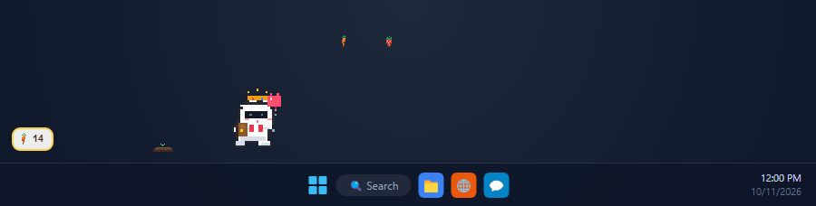
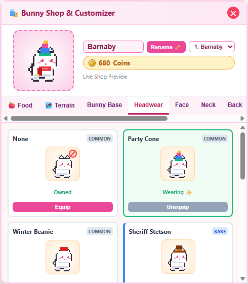
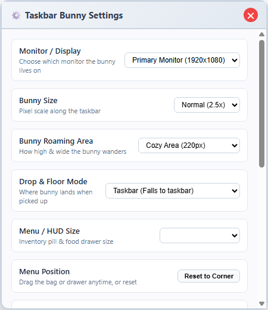

# 🐰 Taskbar Bunny

<p align="center">
  
</p>

A cozy, lightweight, pixel-art desktop pet game for Windows that lives directly on top of your taskbar, in the spirit of *Taskbar Hero*.

Barnaby hops, wanders, nibbles carrots, takes naps, and reacts to your interactions—all while running quietly in the background without stealing focus or blocking your clicks.

---

## 📸 Screenshots

<p align="center">
  
  &nbsp;&nbsp;&nbsp;&nbsp;
  
</p>
<p align="center">
  <em>Left: Live Animated Wardrobe & Customizer &bull; Right: Companion Settings & Multi-Monitor Controls</em>
</p>

---

## ✨ Features

- **Transparent & Non-Intrusive**:
  - Automatically docks right on top of the Windows taskbar across screen resolutions.
  - **100% Click-Through**: You can click your desktop icons and apps underneath freely. Mouse events are only captured when interacting with the bunny or the floating bag.
  - Never appears in the taskbar app list or Alt+Tab (`skipTaskbar: true`).
  - Does not steal focus from your active apps (`focusable: false`).
- **Cozy Bunny AI & State Machine**:
  - Natural behavioral cycle: idle, walk, sit, groom face, hop, eat treats, and curl into a loaf to sleep.
  - Real-time hunger decay (relaxed ~60m, normal ~30m, fast ~15m).
  - Sleeps automatically during late night hours (system clock) or when ignored for long periods.
  - Never dies! A hungry bunny simply walks slower, looks sad, and shows a thought bubble.
- **Interactive Physics**:
  - **Pet**: Click to pet (spawns hearts, boosts happiness, plays chime).
  - **Drag & Drop**: Click and drag to pick up the bunny (dangling legs animation) and release to let it bounce back down onto the taskbar.
  - **Double Click**: Double click to make the bunny perform an excited high hop!
- **Feeding & Carrot Garden**:
  - Drop carrots, lettuce, apple slices, four-leaf clovers, and strawberries onto the taskbar.
  - The bunny notices the treat, walks over, and crunches it down with crumb particles and sound effects.
  - Mini garden plot on the taskbar: carrots grow in real time and can be harvested for bonus carrots, coins, and XP!
  - Passive income: earn free carrots periodically just by keeping the app open.
- **Deep Wardrobe & Layered Cosmetics**:
  - Live animated 32x32 wardrobe preview with 4x scaling.
  - Customize fur coat (Snow White, Chestnut Brown, Cloud Gray, Midnight Charcoal, Pastel Sakura, Caramel Honey, Dutch Patch), ear styles (Upright, Floppy, Derpy), eye colors, and blush.
  - Layered accessory slots: **Headwear** (Party Hat, Beanie, Cowboy Stetson, Wizard Hat, Floral Crown, Gamer Headset, Royal Crown, Bunny Ears Headband), **Face** (Glasses, Sunglasses, Monocle, Mustache), **Neck** (Red Scarf, Bow Tie, Bell Collar, Flower Lei), **Back** (Backpack, Hero Cape, Angel Wings), and **Held Items** (Heart Balloon, Cheering Flag, Lollipop, Star Wand).
  - Save and load up to 3 outfit presets.
- **Offline Progress**:
  - Accurately tracks elapsed time while closed. Crops finish growing, hunger is gently adjusted (with a safety cap so it's never punitive), and daily login streak rewards are granted.
- **Multi-Monitor & System Tray**:
  - Choose which monitor the bunny lives on in settings.
  - System tray menu with quick Show/Hide, Wardrobe, Settings, and Feed Carrot shortcuts.
  - Toggle "Start with Windows" in settings.
  - "Do Not Disturb" mode to keep the bunny still and quiet.
- **Expanded Roaming Area & Movable Menu**:
  - Full display transparent click-through overlay. Move the bunny around anywhere across your screen, and customize roaming height in Settings (Taskbar line, Cozy 220px, Lower Desk 450px, or Full Screen free roam).
  - Flexible floor mode: keep the bunny attached to the taskbar, or enable "Free Perch" to let the bunny live and walk at whatever height you place it!
  - The inventory pill and food drawer menu are fully draggable—click and drag the bag button or drawer card anywhere on screen, and your chosen position is automatically remembered.
- **Lightweight & Zero-Asset Web Audio**:
  - Pure vanilla JavaScript and HTML Canvas.
  - Minimal resource footprint with adaptive idle frame throttling.
  - Procedural sound effects generated on-the-fly via the Web Audio API (crunch, hop, pet, fanfare, chime).

---

## 🎮 How to Play / Download

### For Players (Download Executable)
1. Go to the [Releases](https://github.com/CpzXD/TaskBar-Bunny/releases) page on GitHub.
2. Download the standalone executable: **[Taskbar-Bunny-Portable.exe](https://github.com/CpzXD/TaskBar-Bunny/releases/latest/download/Taskbar-Bunny-Portable.exe)** from the [Latest Release](https://github.com/CpzXD/TaskBar-Bunny/releases/latest).
3. Run it and Barnaby will immediately appear sitting on your taskbar!

### 🛡️ Windows SmartScreen / Security Note
Because **Taskbar Bunny** is a free indie open-source project and not code-signed with an expensive corporate enterprise certificate ($400+/year), Windows SmartScreen may show a prompt on first launch:
> *"Windows protected your PC — Microsoft Defender SmartScreen prevented an unrecognized app from starting."*

**How to open:**
1. Click **"More info"** on the popup.
2. Click **"Run anyway"**.

> **Note**: Taskbar Bunny is open-source, runs locally, makes no network calls (see `src/`), contains zero telemetry, and saves game data strictly on your local computer in `%APPDATA%\taskbar-bunny`.

---

### For Developers & Running from Source
```bash
# Clone the repository
git clone https://github.com/CpzXD/TaskBar-Bunny.git
cd TaskBar-Bunny

# Install dependencies
npm install

# Start the game (runs build and launches Electron)
npm start
```

### Packaging Windows .exe Releases
```bash
# Package portable .exe into the /dist folder
npm run build:portable

# Or package full Windows installer (.exe) into /dist
npm run build
```

---

## 🎨 How to Add New Customizations

All game definitions are located in clean, modular files:

### 1. Adding a New Food
1. Open `src/shared/constants.js`:
   Add your food entry to `FOODS`:
   ```javascript
   watermelon: {
     id: 'watermelon',
     name: 'Juicy Watermelon',
     hungerRestore: 50,
     happinessBonus: 25,
     cost: 35,
     color: '#22c55e',
     description: 'Cool and sweet summer treat!'
   }
   ```
2. Open `src/renderer/sprites/itemSprites.js`:
   Add a case to `ItemSprites.drawFood(ctx, foodId, x, y)` drawing the 16x16 pixel sprite.
3. Open `src/renderer/ui/hud.js`:
   Add `'watermelon'` to `this.foodKeys`.
4. Run `npm run build:renderer` (or `npm start`).

### 2. Adding a New Hat or Accessory
1. Open `src/shared/constants.js`:
   Add your item to `ACCESSORIES.head`, `face`, `neck`, `back`, or `held`:
   ```javascript
   { id: 'chef_hat', name: 'Chef Toque', tier: 'rare', price: 75 }
   ```
2. Open `src/renderer/sprites/accessories.js`:
   Add the drawing logic inside `AccessoryRenderer.renderAccessories`:
   ```javascript
   case 'chef_hat':
     rect(hx - 4, hy - 8, 8, 8, '#ffffff');
     rect(hx - 5, hy - 2, 10, 2, '#e2e8f0');
     break;
   ```
   *(All coordinates automatically inherit `hx`, `hy`, `direction`, and bobbing offsets!)*
3. Run `npm run build:renderer`.

### 3. Adding a New Fur Palette
1. Open `src/renderer/sprites/palette.js`:
   Add a new fur palette under `PALETTES.fur`:
   ```javascript
   lavender: {
     outline: '#2e1065',
     base: '#e9d5ff',
     shadow: '#c084fc',
     highlight: '#f3e8ff',
     innerEar: '#f472b6',
     innerEarShadow: '#db2777',
     nose: '#9333ea'
   }
   ```
2. Open `src/shared/constants.js`:
   Add `lavender: { id: 'lavender', name: 'Pastel Lavender', base: '#e9d5ff' }` to `FUR_COLORS`.

---

## 🛠️ Project Architecture

```
taskbar-bunny/
├── package.json
├── build.js                     # 50ms esbuild bundler for renderer scripts
├── assets/
│   ├── icon.png                 # Bunny application icon
│   └── tray-icon.png            # 16x16 pixel system tray icon
└── src/
    ├── main/
    │   ├── main.js              # Single-instance lock, lifecycle, IPC routes
    │   ├── windowManager.js     # Transparent overlay, multi-monitor bounds calculation
    │   ├── trayManager.js       # System tray icon and context menu
    │   ├── storage.js           # JSON persistence in AppData with offline progress
    │   └── preload.js           # Secure contextBridge API
    ├── shared/
    │   └── constants.js         # Balance constants, catalogs, achievements, defaults
    └── renderer/
        ├── index.html           # Transparent overlay window HTML
        ├── styles.css           # Pixel-crisp canvas styles
        ├── app.js               # Renderer application coordinator
        ├── engine/
        │   ├── gameLoop.js      # 30 FPS loop with intelligent idle throttling
        │   ├── inputManager.js  # Hover hit-testing and click-through toggling
        │   └── soundEngine.js   # Zero-asset Web Audio procedural SFX synthesizer
        ├── bunny/
        │   ├── bunny.js         # Physics, dragging, state machine entity, particles
        │   ├── stateMachine.js  # Behavioral states: idle, walk, sit, groom, sleep, hop, eat
        │   └── needs.js         # Hunger decay, happiness, leveling, XP
        ├── sprites/
        │   ├── palette.js       # Fur palettes, eye colors, accents
        │   ├── bunnySprites.js  # 32x32 procedural multi-state sprite generator
        │   ├── accessories.js   # Layered cosmetic renderer with frame anchors
        │   └── itemSprites.js   # Food items, garden stages, thought bubbles
        ├── garden/
        │   └── garden.js        # Carrot garden patch simulation and harvest
        └── ui/
            ├── hud.js           # Docked basket, food drawer, notifications
            ├── wardrobe.html/js # Live 32x32 animated wardrobe modal with presets
            └── settings.html/js # Monitor selection, scale, hunger speed, autostart
```

---

## 💾 Save Data Location

All game progress, statistics, inventory, and customizations are stored locally as clean JSON:
```
%APPDATA%\taskbar-bunny\taskbar-bunny-save.json
```
To reset your data at any time, open Settings and click **Reset All**, or delete the file above.

---

## 👤 Author
Created with ❤️ by **[CpzXD](https://github.com/CpzXD)**.

---

## 📄 License
MIT License. Crafted for cozy desktop companionship.

